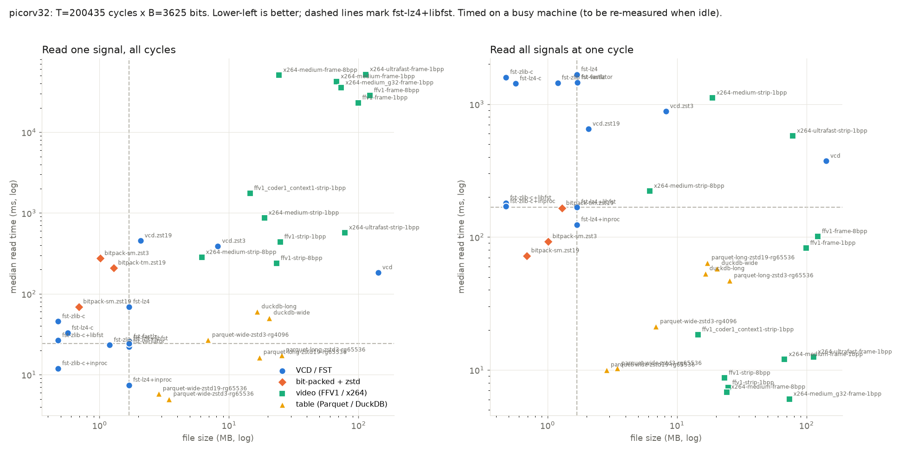

# Storing simulation waveforms as video is a bad idea, and the one thing it wins at

> Draft, not published. Every number comes from `RESULTS.md` and `results/*.csv` in this repository.

A digital simulation waveform is a very large black-and-white image. One axis is clock cycles, the other is every bit of every signal, and each cell is 0 or 1. Most bits do not change from one cycle to the next, just as most pixels do not change from one video frame to the next. Video codecs have spent decades getting good at predicting the next frame. So here is a natural question: if you hand a waveform to a lossless video codec, does it come out smaller than a purpose-built waveform format?

I measured it. It does not, and it is not close.

## Setup

Three open-source RISC-V cores (PicoRV32, SERV, biRISC-V), simulated with Verilator, sampled once per clock cycle, two-state. Waveforms run from 66 thousand to 2.6 million cycles and from 2,381 to 9,728 bits wide. The same content was stored as:

- VCD, VCD with zstd, and several FST packing modes (the baselines)
- FFV1 and lossless x264, in two layouts: one frame per cycle, or one tall strip per 1024 cycles
- Parquet and DuckDB, as a wide table (one column per signal) and a long table (changes only)
- The naive option: bit-pack the 0/1 matrix and run zstd over the whole thing

Every file was decoded and compared bit for bit against the original matrix. Besides size, I timed two reads: one signal across all cycles, and all signals at one cycle. FST reads call GTKWave's libfst in-process.

## Results

Sizes are multiples of the default FST file. Read times are multiples of libfst reading that default FST file. Smaller is better in every column.

| Waveform | Smallest FST | Bit-pack + zstd | Parquet wide: size / one signal / one cycle | FFV1 strip: size / one cycle |
|---|---|---|---|---|
| PicoRV32, 200k cycles | 0.28 | 0.41 | 1.69 / 0.52 / 0.07 | 13.8 / 0.02 |
| SERV, 262k cycles | 0.25 | 0.18 | 1.21 / 0.53 / 0.11 | 5.4 / 0.03 |
| SERV, 2.6M cycles | 0.08 | 0.06 | 1.29 / 0.26 / 0.11 | 6.3 / 0.03 |
| biRISC-V, 66k cycles | 0.55 | 0.65 | 0.80 / 0.97 / 0.15 | 5.9 / 0.03 |
| biRISC-V, 262k cycles | 0.54 | 0.66 | 0.80 / 0.92 / 0.15 | 6.3 / 0.04 |

(Timings from the idle re-run with turbo boost off.)

(Each point is one format. Both axes are logarithmic, and lower-left is better. Green squares are video; blue circles are VCD and FST.)

**Video loses on size.** The best video variant is 1.8 to 3.7 times the default FST file, and most are 5 to 70 times. The most intuitive layout, one frame per cycle, is the worst. A few thousand bits become a tiny image 64 pixels wide, and per-frame overhead eats the gain. Reading one signal then means decoding every frame, which takes tens of seconds.

**Video does not even beat the naive option.** Bit-packing the matrix and running zstd, with no knowledge of waveforms, produces a file several times to over ten times smaller than the best video variant. Video predictors are built for natural images: smooth gradients and moving objects. Waveforms have different regularities. Many bits never change, a few toggle constantly, and the bits of one bus are related arithmetically. A general byte-level compressor fits that better.

**Reordering signals helps, but not enough.** Placing signals with similar values next to each other shrinks FFV1 by up to half. It is still roughly 3 to 9 times the size of FST.

**The one thing video wins at is jumping to a point in time.** Every FFV1 frame is coded independently, so seeking to a frame and decoding it takes 5 to 10 ms. That is a twenty-fifth to a fortieth of the FST time, and it does not grow as the waveform gets longer. FST has to unpack a whole data block to answer the same query. If your workload is random snapshots of every signal across a very long waveform, this is a real advantage. It costs you at least five times the disk.

## Two side findings

**A wide Parquet table does better than I expected.** With one column per signal, its size is in the same range as default FST (0.8 to 2 times), and reading all signals at one cycle is 7 to 15 times faster than FST. Reading one signal across all cycles depends on the design: about twice as fast or more on PicoRV32 and SERV, a tie on biRISC-V. It does not beat the smallest FST mode, and the gap widens as the waveform gets quieter.

**Table orientation decides everything.** The earlier vcd2df work (arXiv 2505.06470) stored waveforms as Parquet and found the result larger than VCD. I reproduced its orientation, one column per time point. With the same content and the same compression, that file is 10 times the size of the one-column-per-signal file. A columnar format needs long columns to pay off, so time belongs on the rows.

## Limits of these results

Three small RISC-V cores only. At most 2.6 million cycles. Two-state only, with no x or z. One clock, one sample per cycle. All timings were taken on one laptop (idle, turbo boost off), so they are good for ratios, not for absolute performance; turning turbo off was enough to flip which format reads one signal faster on one design. FST was not tuned; in particular I did not change its block size. Real project waveforms are larger, contain x, and span several clock domains, and I have not checked whether the conclusions hold there.

What this supports is narrower: within that range, "waveform as video" does not work, and not by a small margin. If what you need is random snapshots by time, a Parquet table with one column per signal gets you most of that speed for far less disk than video.

The code, the raw measurements, and the command behind every number are in the repository.
