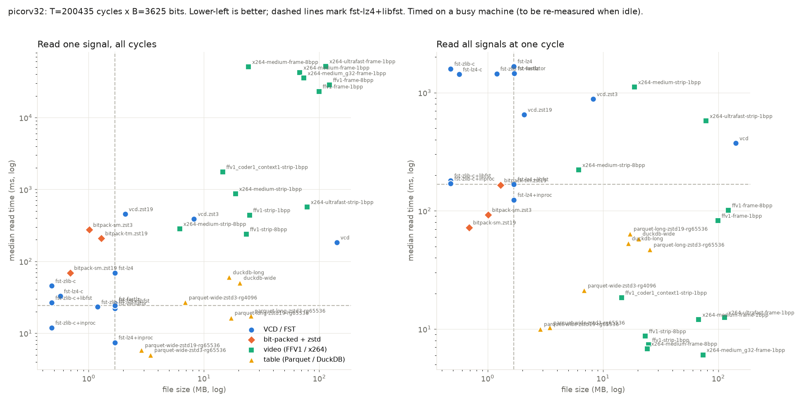

# 把仿真波形当视频存是个坏主意，以及它唯一赢的一项

> 草稿，未发布。数字全部来自本仓库的 `RESULTS.md` 和 `results/*.csv`。

数字仿真的波形可以看成一张很大的黑白图：横轴是时钟周期，纵轴是每一根信号线的每一位，每个格子非 0 即 1。相邻两个周期的大部分位不变，这和视频里相邻两帧大部分像素不变是一回事。视频编码器在“预测下一帧”上已经做了几十年，于是有个自然的想法：把波形直接交给无损视频编码器，会不会比波形专用格式压得更小？

我实际测了一遍。结论是不会，而且差得很远。

## 怎么测的

三个开源 RISC-V 核（PicoRV32、SERV、biRISC-V），用 Verilator 仿真，每个周期采一次样，两态。波形长度从 6.6 万到 262 万周期，宽度 2,381 到 9,728 位。同一份内容分别存成：

- VCD、VCD 加 zstd、FST 的几种打包档位（对照）
- FFV1 和 x264 无损视频，试了两种排法：每个周期一帧；或者每 1024 个周期拼成一帧长条
- Parquet 和 DuckDB，宽表（每个信号一列）和长表（只存变化）
- 最朴素的做法：把 0/1 矩阵按位打包，整体用 zstd 压一遍

每个文件解码后都和原矩阵逐位比对，不相同就不算数。除了体积，还测了两种读法的耗时：取一个信号的全程；取某一时刻的全部信号。FST 的读取是在进程内直接调 GTKWave 的 libfst。

## 结果

下表里体积是相对 FST 默认档的倍数，读取耗时是相对 libfst 读 FST 默认档的倍数，都是越小越好。

| 波形 | FST 最小档 | 打包 + zstd | Parquet 宽表：体积 / 取信号 / 取时刻 | FFV1 长条：体积 / 取时刻 |
|---|---|---|---|---|
| PicoRV32，20 万周期 | 0.28 | 0.41 | 1.69 / 0.78 / 0.08 | 13.8 / 0.07 |
| SERV，26 万周期 | 0.25 | 0.18 | 1.21 / 0.57 / 0.09 | 5.4 / 0.10 |
| SERV，262 万周期 | 0.08 | 0.06 | 1.29 / 0.29 / 0.13 | 6.3 / 0.04 |
| biRISC-V，6.6 万周期 | 0.55 | 0.65 | 0.80 / 1.38 / 0.15 | 5.9 / 0.08 |
| biRISC-V，26 万周期 | 0.54 | 0.66 | 0.80 / 1.38 / 0.25 | 6.3 / 0.06 |

（图里每个点是一种格式，两个轴都是对数，越靠左下越好。绿色方块是视频，蓝色圆点是 VCD 和 FST。）

**视频输在体积上。** 最好的视频变体也是 FST 默认档的 1.8 到 3.7 倍，多数是 5 到 70 倍。最直观的“每个周期一帧”恰恰最差：几千位排成一张 64 像素宽的小图，每帧的固定开销就把收益吃光了，而且要取一个信号就得把全部帧解码一遍，要几十秒。

**视频连最朴素的办法都赢不了。** 把矩阵按位打包后直接 zstd，没有任何波形知识，体积却只有最好的视频变体的几分之一到十几分之一。视频编码器的预测模型是为自然图像设计的：平滑的渐变、运动的物体。波形里是另一种规律：大量位长期不变，少数位剧烈翻转，同一个总线的各位之间有算术关系。通用的字节级压缩反而更对路。

**把信号重新排序有帮助，但不够。** 把取值相似的信号排在一起，FFV1 最多能缩小一半，仍然是 FST 的近 3 到 9 倍。

**它唯一赢的一项是“跳到某一时刻”。** FFV1 的每一帧都独立编码，定位到某一帧再解码只要约 10 毫秒，是 FST 的十分之一到二十分之一，而且不随波形变长而变慢。FST 取某一时刻要解开一整个数据块。如果你的用法是在很长的波形里随机跳着看全部信号的快照，这是个真实的优点，只是要付出 5 倍以上的磁盘。

## 顺带的两个发现

**Parquet 宽表比预想的好。** 每个信号一列，体积和 FST 默认档在同一个量级（0.8 到 2 倍），取某一时刻比 FST 快 4 到 12 倍。取一个信号的全程则和 FST 大致打平，谁快取决于设计。它比不过 FST 的最小档，波形越闲差距越大。

**表的方向决定一切。** 已有的 vcd2df 工作（arXiv 2505.06470）把波形存成 Parquet，结论是比 VCD 还大。我复现了它的方向：一列一个时间点。同一份内容、同一种压缩，这样存出来的文件是“一列一个信号”的 10 倍。列式格式要让每一列足够长才划算，把时间放在行上才对。

## 这些结果的边界

只有三个小型 RISC-V 核；最长 262 万周期；只有两态，没有 x 和 z；单时钟、每周期采样一次。所有耗时都是在一台同时跑着别的任务的笔记本上测的，只能比较倍数，不能当绝对性能引用。FST 一侧没有调数据块大小。真实工程里的波形更大、带 x、多时钟，结论在那里是否成立没有验证。

所以这篇文章能说的是：在这个范围内，“波形即视频”不成立，而且不是差一点；如果你需要的是按时刻随机取快照，一张按信号分列的 Parquet 表是比视频便宜得多的选择。

代码、原始数据和每个数字对应的命令都在仓库里。
